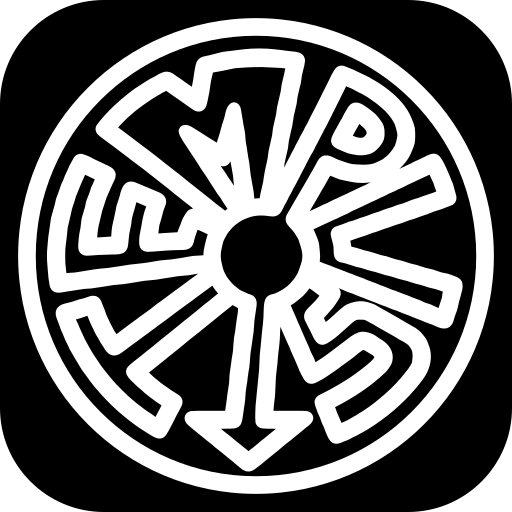

<div align="center">

  <a href="https://tempusplay.com" target="_blank" rel="noopener noreferrer">
    
  </a>

  # TEMPUS

  **Explore world history across a 4.54-billion-year timeline.**  
  *Pinpoint dates, compare eras, and compete in real-time head-to-head chronological duels.*

  <br />

  <!-- PRIMARY CTA BUTTON -->
  <a href="https://tempusplay.com" target="_blank" rel="noopener noreferrer">
    
  </a>

  <p align="center">
    <a href="https://tempusplay.com/guess" target="_blank" rel="noopener noreferrer"><b>🎯 Play /guess</b></a> &nbsp;•&nbsp;
    <a href="https://tempusplay.com/compare" target="_blank" rel="noopener noreferrer"><b>⚖️ Play /compare</b></a> &nbsp;•&nbsp;
    <a href="https://tempusplay.com/versus" target="_blank" rel="noopener noreferrer"><b>⚔️ Play /versus</b></a>
  </p>

  <br />

  <!-- TECH STACK BADGES -->
  <p align="center">
    
    
    
    
    
  </p>

</div>

---

## 🎮 Game Modes & Features

<table>
  <tr>
    <td width="50%" valign="top">
      <h3>🎯 Solo Modes & Daily Challenges</h3>
      <ul>
        <li><b>Date Guessing (<a href="https://tempusplay.com/guess" target="_blank" rel="noopener noreferrer"><code>/guess</code></a>):</b> Place historical events on a zero-scroll (<code>100dvh</code>) timeline stage. Graded dynamically by relative error against the event's age.</li>
        <li><b>Comparison (<a href="https://tempusplay.com/compare" target="_blank" rel="noopener noreferrer"><code>/compare</code></a>):</b> High-tempo chronological ordering between paired historical events.</li>
        <li><b>Daily & Thematic Categories:</b> Curated subject categories with tailored difficulty bands and daily challenges.</li>
      </ul>
    </td>
    <td width="50%" valign="top">
      <h3>⚔️ Head-to-Head (<a href="https://tempusplay.com/versus" target="_blank" rel="noopener noreferrer"><code>/versus</code></a>)</h3>
      <ul>
        <li><b>Online Matchmaking:</b> Ranked public duels staking <b>Chrono Rating (KP)</b>.</li>
        <li><b>Friend Rooms:</b> Instant private lobbies shareable via invite links or QR codes, open to both registered players and guests.</li>
        <li><b>Real-Time Sync:</b> Low-latency round synchronization for live competitive play.</li>
      </ul>
    </td>
  </tr>
  <tr>
    <td width="50%" valign="top">
      <h3>🏆 Progression & Economy</h3>
      <ul>
        <li><b>Tempus Points (TP):</b> Earned across solo sets based on chronological accuracy and streaks.</li>
        <li><b>Chrono Rating (KP):</b> Competitive ELO-style rating system for ranked head-to-head matches.</li>
        <li><b>Metal Badge Ladder:</b> 6-tier progression unlocked automatically through gameplay milestones.</li>
      </ul>
    </td>
    <td width="50%" valign="top">
      <h3>🌍 Multilingual By Design</h3>
      <ul>
        <li><b>5 Native Locales:</b> Full support for <b>English, Turkish, German, French, and Spanish</b> (<code>en</code>, <code>tr</code>, <code>de</code>, <code>fr</code>, <code>es</code>).</li>
        <li><b>Localized Content Engine:</b> Seamless language switching across historical event titles, descriptions, and UI.</li>
      </ul>
    </td>
  </tr>
</table>

---

## 🏗️ System Overview

Tempus uses a server-authoritative architecture where game state, grading, and competitive matchmaking are validated entirely on the backend before results reach the client.

```mermaid
graph LR
    Client["Web Client\n(Next.js / React)"]
    Edge["Edge CDN\n(Media Delivery)"]
    App["Application Layer\n(Game Engine & Auth)"]
    DB[("Database\n(State & Chronology)")]

    Client <-->|Interactive UI| App
    Client -->|Optimized Media| Edge
    App <-->|Authoritative State| DB

